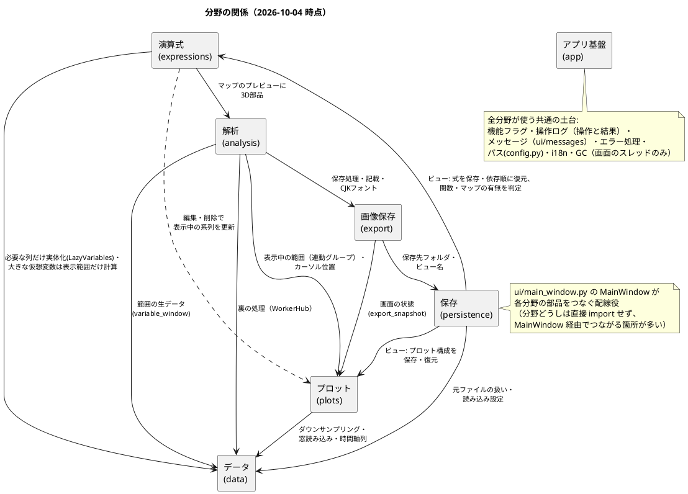

# Parquet Analyzer 総括仕様

- 版数: v1.0（2026-10-02: 仕様書を「総括仕様＋分野ごとの仕様」の構成に組み直した。
  それ以前の版数の履歴は経緯の冒頭）
- 位置づけ: アプリ全体の地図。目的・対象範囲・全体の構成・分野をまたぐ共通ルール・用語を
  ここに置き、各機能の要求と設計は分野ごとの仕様に書く。
- 言語: 日本語版（`*.ja.md`）が作業用の正本。英語版はファイルごとに1対1で対応し（`overview.ja.md` ↔
  `overview.md`、`domains/<x>.ja.md` ↔ `domains/<x>.md` など。2026-10-04作成）、公開の前に追いつかせる。

## 0. 文書の構成と読み方

```
docs/
  overview.ja.md          本書（総括仕様）
  domains/                分野ごとの仕様。各ファイルは「要求」→「設計」の順で、
    data.ja.md              章末に「他の分野との関係」を持つ
    plots.ja.md
    expressions.ja.md
    analysis.ja.md
    persistence.ja.md
    export.ja.md
    app.ja.md
```

（各ファイルに同じ内容の英語版`*.md`がある。）

- **作業するとき**: 本書の「1. 分野の一覧」で該当する分野を見つけ、本書＋その分野の仕様
  （＋その章末の「他の分野との関係」に挙がっている分野の該当節）だけを読む。全部を読む必要は無い。
- **節番号**: 旧`specification.ja.md`の節（`5.13`等）と旧`detailed_specification.ja.md`の章
  （`16章`・`16.2`等）の番号をそのまま見出しに残している。コード中の
  「`detailed_specification.md 16.2`」のような参照は、「6. 旧節番号の対応表」でファイルを引く。
- **新しく仕様を書くとき**: その機能の分野のファイルに、要求は「## 要求」へ、設計は「## 設計」へ
  追記する。番号は通し番号を続ける（要求は`5.22`〜、設計は`28章`〜）——全分野で番号が
  一意になり、コード中の参照がどの分野か迷わないため。設計の章には「テスト計画」の小節を置く。
  分野をまたぐ変更は、主になる分野に書き、関係する分野の「他の分野との関係」と該当箇所に
  参照を足す。
- 解決済みになった課題は未解決の課題から解決済みへ移す（消さない）。
- 本書には変わりにくい内容だけを置く。分野固有の決定は本書に書かない（ずれの原因になるため）。
- **図**: 分野の関係（1.1）・モジュール構成（5.1）は本書の中に` ```plantuml `ブロックで直接
  書く（他のプロジェクト・`project-template`と同じ書き方）。VS CodeのMarkdown Preview Enhanced
  で表示する前提で、GitHubの画面での表示は求めない。`!pragma layout smetana`によりGraphvizは
  不要。分野どうしの関係（各分野の「他の分野との関係」）やモジュールの依存（import）を変えたら、
  図も同じコミットで直す。

## 1. 分野の一覧

| 分野 | ファイル | 範囲 | 主なモジュール |
|---|---|---|---|
| データ | [domains/data.ja.md](./domains/data.ja.md) | Parquetの読み込み、遅延・窓読み込み、時間軸列の選択、ダウンサンプリング、描画中表示、MDF/MATLAB変換ツール | `core/data_source.py`, `core/column.py`, `core/pyramid.py`, `core/downsample.py`, `core/numeric.py`, `core/background_worker.py`, `core/convert.py` |
| プロット | [domains/plots.ja.md](./domains/plots.ja.md) | メイン画面のプロット、ナビゲータ、操作（ズーム・パン）、カーソル、マルチプロット、高さ・並べ替え、系列ごとの操作、X軸の独立 | `ui/plot_widget.py`, `ui/plot_grid.py`, `ui/navigator.py` |
| 演算式 | [domains/expressions.ja.md](./domains/expressions.ja.md) | 変数間演算・仮想変数とその編集、Δ解析、ユーザー関数、マップ、条件分岐（43章） | `core/expression.py`, `core/variable.py`, `core/analysis.py`（delta/rolling_mean）, `ui/expression_bar.py`, `ui/variable_panel.py` |
| 解析 | [domains/analysis.ja.md](./domains/analysis.ja.md) | 統計、FFT、XY/XYZプロット、ヒストグラム（42章） | `core/analysis.py`, `core/histogram.py`, `ui/stats_dialog.py`, `ui/analysis_window.py`, `ui/xy_plot_window.py`, `ui/xy_map_view.py`, `ui/xy_overlay_controller.py`, `ui/histogram_window.py` |
| 保存 | [domains/persistence.ja.md](./domains/persistence.ja.md) | ビュー（JSON・管理画面）、設定ファイル・設定メニュー、レイアウトの永続化 | `io/view.py`, `io/settings.py`, `ui/view_manager.py`, `ui/settings_dialog.py`, `ui/folder_picker.py` |
| 画像保存・書き出し | [domains/export.ja.md](./domains/export.ja.md) | プロットの画像保存（matplotlibでの再描画、記載・メタデータ）、ビューの信号のParquetへの書き出し（57章） | `ui/image_export.py`, `core/parquet_export.py`, `ui/parquet_export_dialog.py` |
| アプリ基盤 | [domains/app.ja.md](./domains/app.ja.md) | ディレクトリ構成・パス、起動、ログ・操作ログ、エラー処理、バージョン、機能フラグ、操作の副作用のテスト（45章） | `config.py`, `core/oplog.py`, `ui/main_window.py`（全体の配線）, `ui/i18n.py` |

### 1.1 分野の関係図

矢印は「左が右を使う／右に影響する」。点線は編集時の更新。各矢印の詳細は
各分野の仕様の「他の分野との関係」。



## 2. 分野をまたぐ共通ルール

各分野の仕様はこれを前提に書かれている。ここに反する設計をする場合は、本書を先に直す。

- **UIスレッドを止めない**: 重い処理（ダウンサンプリング・統計・FFT・解析ウィンドウの計算・
  ピラミッド構築）は`core/background_worker.py`の`WorkerHub`経由で行う（2026-10-03に
  `BackgroundWorker`から変更、[データ 37章](./domains/data.ja.md)）。持ち主ごとに1つの`WorkerHub`
  （普通のPythonオブジェクト）が、受付番号→結果の受け取り先の対応を持ち、それが結果を
  処理し終えるまでの強参照になる。シグナルを出すのはプロセスに1つの消えない中継役のQObjectだけで、
  ハブは弱参照で引く（送り手が処理中に消えると落ちるため）。プールには`QRunnable`の派生ではなく
  普通の呼び出し可能オブジェクトを渡し（PySideの登録の競合で短い処理が残るため）、処理は結果を
  出す前に自分の関数を手放す。
  結果の受け取り先のlambdaは処理そのものを捕まえない（捕まえると解放されないメモリリークになる）。
  **Pythonのガベージコレクションは画面のスレッドでだけ行う**（自動のGCを止め、画面のスレッドから
  定期的に回収する。プールのスレッドでGCが走ると画面の部品を壊して落ちるため）。結果の世代管理は
  **処理単位ごと**（例: 系列ごと）のカウンタで行い、古い結果は捨てる。処理中のジョブが
  あるウィジェットは`deleteLater()`しない（ジョブが0になってから削除）。
  **失敗も必ず通知する**: ワーカーは成功なら`finished`、例外なら`failed`のどちらかを必ず1回出し、
  呼び出し側は両方で後片付け（描画中表示の解除・強参照の解放・「作成中」の印の解除）をする
  （[データ 28章](./domains/data.ja.md)）。
- **プロットの前提**: 時間領域のプロットは並びの先頭側に連続して置き、周波数領域（FFT）の
  プロットはその後ろ。時間領域のプロットは最低1つ残す。X軸が連動している時間領域の
  プロットのうち最初のものが**アンカー**で、ナビゲータ・「表示中の範囲」・ビューの
  X範囲はアンカー（＝連動グループ）を基準にする。
- **時間軸の前提**: 表示範囲・統計・カーソルの計算は時間軸が昇順（重複は可）であることを前提に
  `np.searchsorted`を使う。昇順でない・欠損を含む時間軸は検出して警告する（[データ 29章](./domains/data.ja.md)）。
  警告したうえで表示は続け、**固まらない・落ちない**こと。そのため**pyqtgraphに渡すX座標・範囲・境界には
  非有限値を入れない**（NaNを含む線をQtが描こうとして戻らなくなった。[データ 29.4](./domains/data.ja.md)）。
- **マウスの移動ごとの処理は軽く**: ホバー表示（[プロット 39章](./domains/plots.ja.md)）のように
  マウスの移動のたびに走る処理では、ディスクを読まない（画面に描いているデータだけを使い、
  正確な値は動きが止まってから読む）。操作ログにも書かない。
- **3D表示（OpenGL）**: `QApplication`を作る前に`AA_ShareOpenGLContexts`を設定する。GLの表示の上に
  重ねた部品は実機で文字が描かれないので、ボタン・ラベルは表示の外に置く
  （[解析 25.3・25.5](./domains/analysis.ja.md)）。
- **画面の文字列**はすべて`ui/i18n.py`の`tr()`を通し、`en`と`ja`の両方を用意する。
- **ユーザー操作の記録**: ユーザー操作は`core/oplog.py`の`log_op(...)`で操作ログに残す
  （常時。操作の結果の状態と変化も自動で記録される。[アプリ基盤 30章](./domains/app.ja.md)）。
  利用者に出すメッセージは、記録する共通の関数を通して出す。
- **Qtの状態保存**: ドック・ツールバーには必ず`objectName()`を付ける（無いと
  `saveState`/`restoreState`で黙って失われる）。
- **モーダルダイアログ**（`QMessageBox`/`QInputDialog`/`QFileDialog`）を開きうる処理は、
  テストで必ずモンキーパッチする（タイムアウト機構が無く、テストが永久に止まる）。
  入力補助（変数パネルからのドラッグ等）が必要な画面はモーダルにしない。
- **パス**: `cfg/`（設定）・`data/`（アプリが読み書きするデータ）・`log/`（ログ）は
  `config.py`だけが定義する。直接パスを組み立てない。
- **ビュー**: 計算結果ではなく定義（式・変数名・レイアウト）を保存する。開いたファイルや
  環境に無いものを使う項目は、その項目だけスキップしてまとめて警告する（全体を止めない）。
  ビュー管理画面の「欠けているもの」の印は、`load_view`の実際のスキップと同じ規則で計算する。
  ビューJSONの読み込みは未知のキーを無視し、キーの追加だけなら`schema_version`は上げない。
- **機能フラグ**: 開発中の機能はUIの入口だけを`features.is_enabled(...)`で隠す。計算処理・
  内部API・テストはフラグに関係なく存在し、実行される（[アプリ基盤 21章](./domains/app.ja.md)）。
- **コードから仕様への参照**: docstring・コメントには節番号（例:
  `detailed_specification.md 19.2`）を書く。番号は本書の「6. 旧節番号の対応表」と、
  新しい節の通し番号で引ける。

## 3. 用語

| 用語 | 意味 |
|---|---|
| 時間領域プロット / 周波数領域プロット | X軸が時刻のプロット / X軸がHz（FFT結果）のプロット（`x_axis_datetime`） |
| 系列 | プロットに重ねて表示している1つの変数 |
| 連動グループ・アンカー | X軸が連動している時間領域プロットの集まり・その先頭（2章） |
| 表示中の範囲 | 連動グループのX範囲に対応する行範囲（統計・FFT・XYの対象） |
| 生の変数 / 仮想変数 | ファイルの列 / 式で定義した変数（ビューには式を保存） |
| ユーザー関数・マップ | 式の中で関数として呼べる、ユーザー定義の式・参照テーブル |
| 遅延列・窓読み込み列 | 初めて使われたときに読む列（`LazyColumn`）/ 全体を常駐させず表示範囲だけ読む列（`WindowedColumn`） |
| ピラミッド | 大きい列の粗い最小/最大の包絡線（`core/pyramid.py`） |
| ビュー | 保存した画面構成（`data/parquet_analyzer/*.json`） |
| 機能フラグ | 開発中の機能のUIの入口を出し入れするスイッチ（`features.py`） |
| 外部レビュー1 / 外部レビュー2 | 外部のコードレビュー。仕様書の「外部レビュー#N」「外部レビュー1の#N」は1（2026-10-02、静的レビュー）の項目番号、「外部レビュー2の#N」は2（2026-10-04、公開版0.3.0が対象）の項目番号 |

## 4. 全体の要求（目的・動作環境・非機能要件・対象外）

### 1. 目的

Parquetファイルを読み込み、含まれる時系列データを可視化・解析するためのデスクトップツール。
波形（時系列）の確認、ダウンサンプリング表示、変数間演算、周波数解析、差分解析などを
GUI上で行えるようにする。

### 2. 動作環境

| 項目 | 内容 |
|---|---|
| OS | Windows, macOS |
| 言語 | Python |
| パッケージ管理 | uv |
| GUIフレームワーク | PySide6 |
| プロットライブラリ | pyqtgraph（操作するプロット）、matplotlib（画像保存のみ、5.14章） |
| 配布形態 | exe（PyInstaller等でWindows向けにビルド。詳細は 11.5 参照） |

### 9. 非機能要件

- 大容量データ（数百万行）を扱う際も、ダウンサンプリングによりUI操作が数秒以内に反映されること。
- Windows/macOS両対応。
  - **Windowsで気をつけること**（2026-10-04、Windows 11で全件テストを流して見つかったもの。
    `fix/windows-debug`）:
    - 開いているParquetファイルを握りっぱなしにしない。Windowsでは開いたままのファイルを消したり
      上書きしたりできない（WinError 32）。フッター（行グループ・統計）は読んだら閉じる。
    - Windowsにはタイムゾーンのデータベースが無いので、`tzdata`を依存に入れる（入れないと
      タイムゾーン付きの時刻列の統計が黙って空になる）。
    - ビュー名にWindowsでファイル名に使えない文字（`<>:"|?*`）や末尾の`.`・空白があるときは、
      分かりやすいエラーで断る（他のOSでは今まで通り使える）。
- 配布はexeでインストール不要（Windows向け）。
- **開発用の機能フラグ**（2026-10-02追加、ユーザー要望）: 新機能のUIの入口（ツールバーボタン・
  メニュー・ショートカット・設定欄）を、開発中は機能ごとに有効/無効を切り替えられるようにする。
  切替はコード内の一覧で行い、開発時は環境変数で一時的に上書きできる（exe版では上書き不可）。
  ユーザー向けの設定画面には出さない。新機能はフラグOFFのままコミットし、レビューが済んだら
  ONにする。現在デバッグ中のFFT（[5.6](./domains/analysis.ja.md#56-周波数解析)）もこの仕組みで無効にする。
  詳細は[detailed_specification.ja.md 21章](./domains/app.ja.md#21-開発用の機能フラグ2026-10-02追加ユーザー要望)。

### 10. 対象外（スコープ外）

- Parquet以外のファイル形式への**アプリ本体での**直接対応（CSV等の変換は対象外）。MDF・
  MATLAB（`.mat`）は同じ分野でよく使われるが、アプリが直接読むのではなく**別ツール**
  （`tools/convert_to_parquet.sh`）で変換する方式にした。理由は
  [detailed_specification.ja.md 15章](./domains/data.ja.md#15-mdfmatlab--parquet-変換ツール2026-09-18追加)
  参照（これらの形式はParquetのような列・範囲選択的な読み込みに向いた構造ではなく、
  本アプリの効率化設計の一部がParquetの構造に依存しているため）。
- リアルタイムストリーミングデータの表示。

## 5. 全体の設計（技術選定・モジュール構成）

### 1. 技術選定（確定）

| 項目 | 選定 | 理由 |
|---|---|---|
| プロットライブラリ（11.1） | `pyqtgraph` | ドラフト記載の `Pygraph` は `pyqtgraph` の表記ゆれと解釈。PySide6との親和性・大量点描画性能の実績から確定。 |
| Parquet読み込み（11.6） | `polars` | `pl.scan_parquet` によるレイジー評価で、必要な列・行範囲のみ読み込める。列指向処理がAPIとして自然で、`pandas`よりメモリ効率が良い。スキーマ確認など軽量な操作には内部で`pyarrow`も利用する。 |
| exe化（11.5） | `PyInstaller` | PySide6アプリでの実績が豊富。`--onedir`形式で配布し、起動時間の悪化を避ける。 |
| 画像保存（19章） | `matplotlib` | 保存用には画面をキャプチャせず描き直す: X軸を共有して揃え、まともな凡例を付け、SVGをデバイス座標で書き出せる（QtのSVG出力はエポック秒のX値で精度が落ちる。19.0章）。保存時にのみ使い、遅延importする。 |

### 2. モジュール構成

```
src/parquet_analyzer/
├── __init__.py               # __version__（17章）
├── __main__.py               # GUIエントリポイント（GCの見張り役の起動、37章）
├── convert_cli.py            # MDF/MATLAB→Parquet変換のCLIエントリポイント（argparse、Qt非依存）
├── config.py                 # パス定義の共有モジュール（stdlibのみ依存、他プロジェクトからもimport可能）
├── features.py               # 機能フラグ（21章）
├── ui/
│   ├── main_window.py        # MainWindow: ツールバー、全体レイアウト、各部品の結線
│   ├── plot_grid.py          # PlotGridWidget: マルチプロットの配置・連動・カーソル/ホバーの同期
│   ├── plot_widget.py        # TimePlotWidget: ズーム/パン、系列の描画、カーソル、ホバー表示（39章）、
│   │                          # 画像保存用のexport_snapshot()（19.1章）
│   ├── navigator.py          # NavigatorWidget: 縮小全体表示 + 選択範囲矩形（共通・単一）
│   ├── navigator_sync.py     # NavigatorSync: 概観の作成と選択範囲の同期を1か所に（plots 24.9）
│   ├── variable_panel.py     # VariablePanel: 変数一覧、D&D、仮想変数の編集/削除（18.3章）
│   ├── expression_bar.py     # ExpressionBar: 演算式入力欄（編集モードを含む。18.3章）
│   ├── stats_dialog.py       # StatsDialog: 統計結果の非モーダル別ウィンドウ
│   ├── analysis_window.py    # AnalysisWindow: 解析ウィンドウの共通部品（範囲・追従・再計算、25.1章）
│   ├── xy_plot_window.py     # XYPlotWindow: XYプロット（25.2章）、2D/3Dの切替（25.5章）
│   ├── xy_map_view.py        # XYMapViewMixin: XYのマップ・カーブ表示（設定欄・計算・描画・書き出し、44章、44.12）
│   ├── xy_overlay.py         # OverlayState（Qtなし）・等高線の線分・画像保存への重ね描き（44.7、44.12）
│   ├── xy_overlay_controller.py # XYOverlayController: 重ねるメニュー・描画・等高線の値（OverlayHost経由、44.12）
│   ├── histogram_window.py   # HistogramWindow: ヒストグラム（analysis 5.33・42章）
│   ├── xyz_3d_window.py      # Xyz3DView: 3D表示（OpenGL、25.3・25.5章）
│   ├── analysis_common.py    # XY・3Dで共有する小物（区切り、時刻の目盛り）
│   ├── flow_layout.py        # 幅に合わせて折り返すレイアウト（XY/3Dの設定欄、25.5章）
│   ├── function_manager.py   # ユーザー関数の管理画面（26章）
│   ├── map_manager.py        # マップの管理画面（27章）
│   ├── function_reference.py # 関数の一覧・説明のウィンドウ（38章）
│   ├── settings_dialog.py    # SettingsDialog: 設定メニューのダイアログ
│   ├── view_manager.py       # ViewManagerDialog: 保存済みビューの一覧・詳細・読込・削除（20・35章）
│   ├── image_export.py       # matplotlibによるプロットの画像保存（19.2章）
│   ├── parquet_export_dialog.py # ParquetExportDialog（範囲・信号の選択）とステータスバーの進捗部品（export 57.1・57.3）
│   ├── messages.py           # 利用者へのメッセージ（記録してから出す、30章）
│   ├── i18n.py               # tr(): UI文字列をen/jaで一元管理（Settings.language）
│   └── folder_picker.py      # pick_parquet_file(): ファイル選択ダイアログ + 最近のフォルダ
├── core/
│   ├── data_source.py        # ParquetDataSource: polars LazyFrameラップ、スキーマ/範囲読み込み、
│   │                          # フッターのみのメタデータ、ブロックキャッシュ付きread_window()（13.5.1章）
│   ├── column.py             # MaterializedColumn / LazyColumn / WindowedColumn / LazyVariables
│   ├── numeric.py            # to_numeric()、check_time_order()（29章）
│   ├── time_index.py         # TimeIndex: 大きな昇順の時間軸を全件持たない索引（data 36.8 D）
│   ├── pyramid.py            # build_pyramid(): 粗いmin/max包絡、thin_column(): ナビゲータ用の間引き（40章）
│   ├── downsample.py         # lttb(x, y, n_out)
│   ├── background_worker.py  # WorkerHub: UIスレッド外で実行し結果を1回だけ返す、進捗の経路（37章）
│   ├── parquet_export.py     # ビューの信号のParquet書き出し（計画・区切り計算・書き込み、Qtなし。export 57.2）
│   ├── expression.py         # evaluate_expression(): AST許可リスト方式の評価、referenced_names()
│   ├── functions.py          # ユーザー関数・マップを式から呼ぶためのレジストリ（26・27章）
│   ├── maps.py               # LookupTable: カーブ/マップの補間・範囲外の扱い（27章）
│   ├── histogram.py          # ヒストグラムの計算（区切りなし/あり、ローカル時刻の区切り、analysis 42.3）
│   ├── analysis.py           # fft()、sampling_report()（32章）、delta、rolling_mean、basic_stats
│   ├── variable.py           # DerivedVariable; dependency_order(), dependents_of()（18.1章）
│   ├── convert.py            # MDF/MATLAB→Parquet変換（15章）。convert_cli.py経由でのみ使う
│   ├── oplog.py              # 操作ログ、log_op()（30章）
│   └── oplog_view.py         # 操作ログの読みやすい表示（tools/show_ops_log.sh）
└── io/
    ├── view.py               # View、save_view()/load_view()/delete_view()、形の検証（35章）
    ├── settings.py           # Settings、load_settings()/save_settings()
    ├── user_functions.py     # ユーザー関数の保存（26章）
    └── maps.py               # マップのCSV読み込み・保存・改名（27章）
```

各モジュールの責務は上記コメントの通り。`ui/` はPySide6/pyqtgraphに依存し、`core/`・`io/` は
GUI非依存（単体テスト容易性・将来のCLI化に備える）。

### 5.1 モジュール構成図

パッケージ内のimportの関係（2026-10-04時点のコードから作成）。`ui/i18n.py`（`tr`）と`core/oplog.py`（`log_op`）はほぼ全UIモジュールが
使うため矢印を省略し、`main_window`から`core`/`io`への矢印はパッケージ単位にまとめている。

```plantuml
@startuml modules
' モジュールの依存関係（パッケージ内のimport）。2026-10-04時点のコードから作成。
'ui/i18n.py（tr）・core/oplog.py（log_op）・
' ui/messages.py・features.pyはほぼ全UIモジュールが使うため矢印を省略し、注記にまとめた。
' main_windowからcore/ioへの矢印はパッケージ単位にまとめている。
!pragma layout smetana
skinparam defaultFontName "Hiragino Sans"
skinparam shadowing false
skinparam packageStyle rectangle
skinparam rectangle {
  BackgroundColor<<予定>> #EEEEEE
  BorderColor<<予定>> #999999
  FontColor<<予定>> #666666
}

title モジュール構成（src/parquet_analyzer/）

rectangle "config.py" as config
rectangle "features.py" as features

package "ui" as ui {
  rectangle "main_window" as mw
  rectangle "plot_grid" as grid
  rectangle "plot_widget" as pw
  rectangle "navigator" as nav
  rectangle "navigator_sync" as navsync
  rectangle "image_export" as ie
  rectangle "parquet_export_dialog" as pqd
  rectangle "view_manager" as vm
  rectangle "settings_dialog" as sd
  rectangle "stats_dialog" as stats
  rectangle "expression_bar" as eb
  rectangle "variable_panel" as vp
  rectangle "folder_picker" as fp
  rectangle "analysis_window" as aw
  rectangle "xy_plot_window" as xy
  rectangle "xy_map_view" as xymv
  rectangle "xy_overlay_controller" as xyoc
  rectangle "xy_overlay" as xyo
  rectangle "histogram_window" as hist
  rectangle "xyz_3d_window" as xyz
  rectangle "analysis_common / flow_layout" as acom
  rectangle "function_reference" as fref
  rectangle "function_manager" as fm
  rectangle "map_manager" as mm
  rectangle "messages / i18n" as msg
}

package "io" as io {
  rectangle "settings" as settings
  rectangle "view" as view
  rectangle "user_functions" as iouf
  rectangle "maps" as iomaps
}

package "core" as core {
  rectangle "data_source" as ds
  rectangle "column" as col
  rectangle "pyramid" as pyr
  rectangle "time_index" as tix
  rectangle "numeric" as num
  rectangle "downsample" as lttb
  rectangle "background_worker" as bw
  rectangle "expression" as expr
  rectangle "functions" as fn
  rectangle "maps" as cmaps
  rectangle "variable" as var
  rectangle "analysis" as ana
  rectangle "histogram" as chist
  rectangle "parquet_export" as pqe
  rectangle "oplog / oplog_view" as oplog
  rectangle "convert" as conv
}

mw --> grid
mw --> nav
mw --> navsync
mw --> ie
mw --> pqd
mw --> pqe
mw --> vm
mw --> sd
mw --> stats
mw --> eb
mw --> vp
mw --> fp
mw --> xy
mw --> fm
mw --> mm
mw --> xyz
mw --> hist
mw --> fref
fref --> fm
fref --> expr
xy --> xyz
xy --> xymv
xy --> xyoc
xy --> xyo
xyoc --> xyo
xyoc --> xyz
xyo --> pw
xymv ..> xy : 実行時にXY_*定数・_colormap等を参照
xy --> acom
xyz --> acom
xyz --> aw
xyz --> ie
mm --> xyz
mw --> core : data_source, column, numeric, expression,\nfunctions, variable, analysis, background_worker, oplog, time_index
mw --> io : view, settings, user_functions, maps
grid --> pw
pw --> bw
pw --> lttb
pw ..> ie : PlotSnapshot
nav --> lttb
navsync --> nav
navsync --> bw
navsync --> col
navsync --> pyr
navsync --> tix
navsync --> num
xy --> aw
hist --> aw
hist --> chist
hist --> acom
hist --> ie
chist --> num
pqe --> expr
pqe --> fn
pqe --> num
pqe --> var
xy --> pw
aw --> bw
aw --> ie
vm --> expr
vm --> fn
vm --> var
vm --> view
eb --> expr
fm --> expr
fm --> fn
mm --> cmaps
mm --> io

col --> ds
col --> pyr
col --> num
ds --> num
pyr --> num
tix --> ds
tix --> num
tix --> pyr
expr --> ana
expr <..> fn : 相互参照\n（関数内でimport）
var --> expr
iouf --> fn
iomaps --> cmaps
iomaps --> expr
oplog --> settings : ログの保存期間\n（core→ioの例外）

settings --> config
view --> config
iouf --> config
iomaps --> config

note right of features
  機能フラグ（app 21章）。UIの入口
  （main_window・settings_dialog・plot_grid）
  だけが参照する
end note

note bottom of conv
  変換ツール（tools/convert_to_parquet.sh
  → convert_cli.py）からだけ使う。
  GUIアプリからは使わない。
end note
@enduml
```



## 6. 旧節番号の対応表

旧`specification.ja.md`（要求仕様）の節:

| 旧節 | 見出し | 現在の場所 |
|---|---|---|
| 1 | 目的 | [overview.ja.md](./overview.ja.md) |
| 2 | 動作環境 | [overview.ja.md](./overview.ja.md) |
| 3 | ディレクトリ構成 | [domains/app.ja.md](./domains/app.ja.md) |
| 3.1 | 他プロジェクトとのパス共有 | [domains/app.ja.md](./domains/app.ja.md) |
| 4 | 起動方法 | [domains/app.ja.md](./domains/app.ja.md) |
| 5.1 | メイン画面 | [domains/plots.ja.md](./domains/plots.ja.md) |
| 5.2 | ナビゲータ | [domains/plots.ja.md](./domains/plots.ja.md) |
| 5.3 | 操作（v2、実使用フィードバックにより確定） | [domains/plots.ja.md](./domains/plots.ja.md) |
| 5.4 | 自動ダウンサンプリング | [domains/data.ja.md](./domains/data.ja.md) |
| 5.5 | 変数間演算 | [domains/expressions.ja.md](./domains/expressions.ja.md) |
| 5.6 | 周波数解析 | [domains/analysis.ja.md](./domains/analysis.ja.md) |
| 5.7 | Δ（デルタ）解析 | [domains/expressions.ja.md](./domains/expressions.ja.md) |
| 5.8 | ビュー保存機能 | [domains/persistence.ja.md](./domains/persistence.ja.md) |
| 5.9 | データフォルダ選択 | [domains/data.ja.md](./domains/data.ja.md) |
| 5.10 | 設定メニュー | [domains/persistence.ja.md](./domains/persistence.ja.md) |
| 5.11 | レイアウトの永続化 | [domains/persistence.ja.md](./domains/persistence.ja.md) |
| 5.12 | 統計表示 | [domains/analysis.ja.md](./domains/analysis.ja.md) |
| 5.13 | カーソル | [domains/plots.ja.md](./domains/plots.ja.md) |
| 5.14 | プロットの画像保存 | [domains/export.ja.md](./domains/export.ja.md) |
| 5.15 | プロットの高さ変更・並べ替え | [domains/plots.ja.md](./domains/plots.ja.md) |
| 5.16 | 時刻ラベルは必要な所だけに表示 | [domains/plots.ja.md](./domains/plots.ja.md) |
| 5.17 | 系列ごとの操作: 選択・削除・表示/非表示 | [domains/plots.ja.md](./domains/plots.ja.md) |
| 5.18 | プロットごとのX軸の独立 | [domains/plots.ja.md](./domains/plots.ja.md) |
| 5.19 | XY / XYZプロット | [domains/analysis.ja.md](./domains/analysis.ja.md) |
| 5.20 | ユーザー関数 | [domains/expressions.ja.md](./domains/expressions.ja.md) |
| 5.21 | マップ（テーブル） | [domains/expressions.ja.md](./domains/expressions.ja.md) |
| 6 | データ処理 | [domains/data.ja.md](./domains/data.ja.md) |
| 7 | 設定（cfg/） | [domains/persistence.ja.md](./domains/persistence.ja.md) |
| 8 | ログ（log/parquet_analyzer） | [domains/app.ja.md](./domains/app.ja.md) |
| 9 | 非機能要件 | [overview.ja.md](./overview.ja.md) |
| 10 | 対象外（スコープ外） | [overview.ja.md](./overview.ja.md) |

旧`detailed_specification.ja.md`（詳細仕様）の章（章単位。小節は原則として親の章と同じファイル——例外は下の表の後に記載）:

| 旧章 | 見出し | 現在の場所 |
|---|---|---|
| 1 | 技術選定（確定） | [overview.ja.md](./overview.ja.md) |
| 2 | モジュール構成 | [overview.ja.md](./overview.ja.md) |
| 3 | 起動シーケンス | [domains/app.ja.md](./domains/app.ja.md) |
| 4 | 操作仕様（確定・11.3・v2） | [domains/plots.ja.md](./domains/plots.ja.md) |
| 5 | マルチプロット / 重ね合わせ操作（11.7） | [domains/plots.ja.md](./domains/plots.ja.md) |
| 6 | 演算式入力（11.4） | [domains/expressions.ja.md](./domains/expressions.ja.md) |
| 7 | データソース選択とフォルダ履歴 | [domains/data.ja.md](./domains/data.ja.md) |
| 8 | View JSONスキーマ | [domains/persistence.ja.md](./domains/persistence.ja.md) |
| 9 | 設定ファイル (`cfg/parquet_analyzer/settings.json`) | [domains/persistence.ja.md](./domains/persistence.ja.md) |
| 10 | ダウンサンプリング再計算の非同期化（確定） | [domains/data.ja.md](./domains/data.ja.md) |
| 11 | ログ仕様 | [domains/app.ja.md](./domains/app.ja.md) |
| 12 | エラーハンドリング方針 | [domains/app.ja.md](./domains/app.ja.md) |
| 14 | 統計表示 | [domains/analysis.ja.md](./domains/analysis.ja.md) |
| 15 | MDF/MATLAB → Parquet 変換ツール | [domains/data.ja.md](./domains/data.ja.md) |
| 16 | カーソル | [domains/plots.ja.md](./domains/plots.ja.md) |
| 17 | バージョン埋め込み | [domains/app.ja.md](./domains/app.ja.md) |
| 18 | 仮想変数の編集・削除 | [domains/expressions.ja.md](./domains/expressions.ja.md) |
| 19 | プロットの画像保存 | [domains/export.ja.md](./domains/export.ja.md) |
| 20 | ビュー管理ウィンドウ | [domains/persistence.ja.md](./domains/persistence.ja.md) |
| 21 | 開発用の機能フラグ | [domains/app.ja.md](./domains/app.ja.md) |
| 22 | プロットの高さ変更・並べ替え・時刻ラベル | [domains/plots.ja.md](./domains/plots.ja.md) |
| 23 | 系列ごとの選択・削除・表示/非表示 | [domains/plots.ja.md](./domains/plots.ja.md) |
| 24 | プロットごとのX軸の独立 | [domains/plots.ja.md](./domains/plots.ja.md) |
| 25 | XY / XYZプロット | [domains/analysis.ja.md](./domains/analysis.ja.md) |
| 26 | 関数レジストリとユーザー関数 | [domains/expressions.ja.md](./domains/expressions.ja.md) |
| 27 | マップ（テーブル） | [domains/expressions.ja.md](./domains/expressions.ja.md) |

親の章と別のファイルにある小節:

| 旧節 | 見出し | 現在の場所 |
|---|---|---|
| 4.2 | 時間軸（X軸）に使う列の選択 | [domains/data.ja.md](./domains/data.ja.md) |
| 9.2 | 描画中インジケータ | [domains/data.ja.md](./domains/data.ja.md) |

