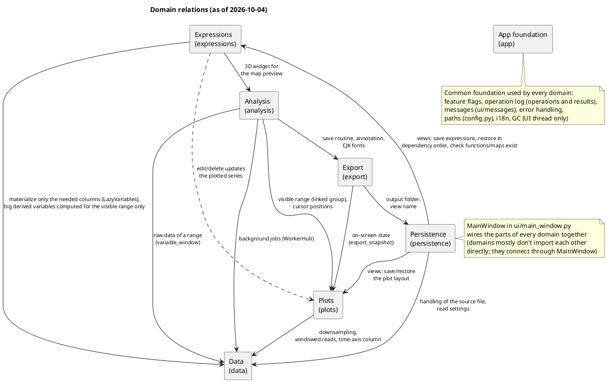

# Parquet Analyzer — Overview Specification

- Revision: v1.0 (2026-10-02: the specification was reorganized into "overview + per-domain
  specifications". The revision history before that is at the top of history)
- Role: the map of the whole application. The purpose, scope, overall structure, rules shared
  across domains and the glossary live here; each feature's requirements and design live in the
  per-domain specifications.
- Language: the Japanese edition (`*.ja.md`) is the authoritative working copy. This English
  edition mirrors it file for file (`overview.ja.md` ↔ `overview.md`, `domains/<x>.ja.md` ↔
  `domains/<x>.md`, …) and is brought up to date when publishing.

## 0. How the documents are organized and how to read them

```
docs/
  overview.md             this document (overview specification)
  domains/                per-domain specifications. Each file goes "Requirements" → "Design"
    data.md                 and ends with "Relations to other domains"
    plots.md
    expressions.md
    analysis.md
    persistence.md
    export.md
    app.md
  dev notes              task list (where work is tracked), open issues and remaining tasks
  dev notes              record of resolved investigations and decisions (e.g. the old 13.5.1
                          large-file memory work)
```

(Each file has a Japanese counterpart `*.ja.md` with the same content.)

- **When working on something**: find the domain in "1. Domains" below and read only this
  document + that domain's specification (+ the relevant sections of the domains listed in its
  "Relations to other domains"). There is no need to read everything.
- **Section numbers**: the section numbers of the old `specification.ja.md` (`5.13`, …) and the
  chapter numbers of the old `detailed_specification.ja.md` (`ch. 16`, `16.2`, …) are kept in the
  headings. A reference in the code such as "`detailed_specification.md 16.2`" is looked up in
  "6. Old section number table" to find the file.
- **When writing a new specification**: add the requirement under "## Requirements" and the
  design under "## Design" in that feature's domain file. Numbering continues the running
  sequence (requirements from `5.22`, design from ch. `28`) — so that numbers are unique across
  all domains and a reference in the code never leaves you guessing which domain it is in. Each
  design chapter has a "Test plan" subsection. A change spanning domains is written in the main
  domain, and references are added to the "Relations to other domains" and the relevant places of
  the other domains.
- Issues that become resolved are moved from `dev notes` to `history` (not deleted).
- Only stable content goes in this document. Domain-specific decisions are not written here (it
  would cause drift).
- **Diagrams**: the domain relations (1.1) and the module structure (5.1) are written directly in
  this document as ` ```plantuml ` blocks (the same way as other projects and
  `project-template`). They are meant to be viewed with VS Code's Markdown Preview Enhanced;
  rendering on GitHub is not required. `!pragma layout smetana` removes the need for Graphviz.
  When the relations between domains (each domain's "Relations to other domains") or the module
  dependencies (imports) change, fix the diagrams in the same commit.

## 1. Domains

| Domain | File | Scope | Main modules |
|---|---|---|---|
| Data | [domains/data.md](./domains/data.md) | Reading Parquet, lazy/windowed reading, choosing the time-axis column, downsampling, the drawing indicator, the MDF/MATLAB conversion tool | `core/data_source.py`, `core/column.py`, `core/pyramid.py`, `core/downsample.py`, `core/numeric.py`, `core/background_worker.py`, `core/convert.py` |
| Plots | [domains/plots.md](./domains/plots.md) | The main window's plots, the navigator, interaction (zoom/pan), cursors, multiple plots, height/reordering, per-series operations, independent X axes | `ui/plot_widget.py`, `ui/plot_grid.py`, `ui/navigator.py` |
| Expressions | [domains/expressions.md](./domains/expressions.md) | Inter-variable expressions, derived variables and their editing, Δ analysis, user functions, maps, conditional branches (ch. 43) | `core/expression.py`, `core/variable.py`, `core/analysis.py` (delta/rolling_mean), `ui/expression_bar.py`, `ui/variable_panel.py` |
| Analysis | [domains/analysis.md](./domains/analysis.md) | Statistics, FFT, XY/XYZ plots, histogram (ch. 42) | `core/analysis.py`, `core/histogram.py`, `ui/stats_dialog.py`, `ui/analysis_window.py`, `ui/xy_plot_window.py`, `ui/xy_map_view.py`, `ui/xy_overlay_controller.py`, `ui/histogram_window.py` |
| Persistence | [domains/persistence.md](./domains/persistence.md) | Views (JSON, manager window), the settings file and settings menu, layout persistence | `io/view.py`, `io/settings.py`, `ui/view_manager.py`, `ui/settings_dialog.py`, `ui/folder_picker.py` |
| Export | [domains/export.md](./domains/export.md) | Saving the plots as an image (re-drawn with matplotlib, annotation and metadata) | `ui/image_export.py` |
| App foundation | [domains/app.md](./domains/app.md) | Directory layout and paths, startup, logs and the operation log, error handling, version, feature flags, tests for side effects of operations (ch. 45) | `config.py`, `core/oplog.py`, `ui/main_window.py` (overall wiring), `ui/i18n.py` |

### 1.1 Domain relation diagram

An arrow means "the left uses / affects the right". Dotted arrows are updates on edit. The
details of each arrow are in each domain's "Relations to other domains".



## 2. Rules shared across domains

Every domain's specification assumes these. A design that goes against them must change this
document first.

- **Never block the UI thread**: heavy work (downsampling, statistics, FFT, analysis-window
  computations, pyramid builds) goes through `WorkerHub` in `core/background_worker.py`
  (changed from `BackgroundWorker` on 2026-10-03, [data ch. 37](./domains/data.md)). One
  `WorkerHub` per owner (a plain Python object) maps ticket → result receiver and is the strong
  reference until the receiver has handled the result. Only one never-deleted relay QObject per
  process emits signals, and it looks the hub up through a weak reference (the app would crash if
  the sender disappeared mid-job). The pool is given plain callables, not `QRunnable` subclasses
  (PySide's registration races left short jobs behind), and a job drops its function before
  emitting its result.
  The lambdas that receive results never capture the job itself (that would be a memory leak
  that is never freed).
  **Python garbage collection runs only on the UI thread** (automatic GC is off and the UI
  thread collects periodically; GC on a pool thread destroyed UI objects and crashed). Results
  are versioned with **per-unit** counters (e.g. per series) and stale results are dropped. A
  widget with jobs in flight is not `deleteLater()`-ed (it is deleted once its job count is 0).
  **Failures are always reported too**: a worker emits exactly one of `finished` on success or
  `failed` on an exception, and callers clean up on both (clear the drawing indicator, release
  strong references, clear "being built" marks) ([data ch. 28](./domains/data.md)).
- **Plot assumptions**: time-domain plots come first and contiguously, frequency-domain (FFT)
  plots after them. At least one time-domain plot always remains. The first time-domain plot
  whose X axis is linked is the **anchor**; the navigator, the "visible range" and a view's X
  range are based on the anchor (= the linked group).
- **Time-axis assumption**: visible-range, statistics and cursor computations assume the time
  axis is ascending (duplicates allowed) and use `np.searchsorted`. A time axis that is not
  ascending or contains missing values is detected and warned about
  ([data ch. 29](./domains/data.md)). After the warning, display continues and must **never
  freeze or crash**. For that reason **never hand pyqtgraph a non-finite X coordinate, range or
  bound** (Qt never returned when painting a line containing NaN; [data 29.4](./domains/data.md)).
- **Keep per-mouse-move work light**: work that runs on every mouse move, such as the hover
  readout ([plots ch. 39](./domains/plots.md)), never reads from disk (it uses only the data
  drawn on screen and reads exact values after the movement stops). It is not written to the
  operation log either.
- **3D display (OpenGL)**: set `AA_ShareOpenGLContexts` before creating the `QApplication`.
  Widgets laid over a GL view don't render their text on a real display, so buttons and labels go
  outside the view ([analysis 25.3, 25.5](./domains/analysis.md)).
- **On-screen strings** all go through `tr()` in `ui/i18n.py`, with both `en` and `ja`.
- **Recording user operations**: user operations are written to the operation log with
  `log_op(...)` from `core/oplog.py` (always; the resulting state and what changed are recorded
  automatically, [app ch. 30](./domains/app.md)). Messages shown to the user go through the
  shared function that records them.
- **Qt state saving**: docks and toolbars must have an `objectName()` (otherwise they are
  silently lost by `saveState`/`restoreState`).
- **Modal dialogs** (`QMessageBox`/`QInputDialog`/`QFileDialog`): code that can open one must be
  monkeypatched in tests (there is no timeout mechanism and the test would hang forever). Windows
  that need input assistance (dragging from the variable panel, etc.) are not modal.
- **Paths**: `cfg/` (settings), `data/` (data the app reads and writes) and `log/` (logs) are
  defined only by `config.py`. Never build such paths directly.
- **Views**: save definitions (expressions, variable names, layout), not computed results. An
  item that uses something the open file or the environment doesn't have is skipped on its own,
  with one consolidated warning (the rest still loads). The view manager's "missing" marks are
  computed by the same rules as what `load_view` actually skips. Reading a view's JSON ignores
  unknown keys; adding keys alone does not bump `schema_version`.
- **Feature flags**: unfinished features hide only their UI entry points with
  `features.is_enabled(...)`. Computation, internal APIs and tests exist and run regardless of
  the flag ([app ch. 21](./domains/app.md)).
- **References from code to the spec**: docstrings and comments cite the section number (e.g.
  `detailed_specification.md 19.2`). The number is found through "6. Old section number table" in
  this document and the running numbering of new sections.

## 3. Glossary

| Term | Meaning |
|---|---|
| Time-domain plot / frequency-domain plot | A plot whose X axis is time / whose X axis is Hz (FFT result) (`x_axis_datetime`) |
| Series | One variable overlaid on a plot |
| Linked group, anchor | The time-domain plots whose X axes are linked, and the first of them (section 2) |
| Visible range | The row range corresponding to the linked group's X range (the target of statistics, FFT, XY) |
| Raw variable / derived variable | A column of the file / a variable defined by an expression (views store the expression) |
| User function, map | A user-defined expression / lookup table callable as a function in expressions |
| Lazy column, windowed column | A column read when first used (`LazyColumn`) / a column never held whole, reading only the visible range (`WindowedColumn`) |
| Pyramid | A coarse min/max envelope of a big column (`core/pyramid.py`) |
| View | A saved screen configuration (`data/parquet_analyzer/*.json`) |
| Feature flag | A switch that shows or hides the UI entry points of an unfinished feature (`features.py`) |
| External review 1 / External review 2 | External code reviews. In the spec, "external review #N" and "external review 1 #N" are item numbers of review 1 (2026-10-02, static review); "external review 2 #N" are item numbers of review 2 (2026-10-04, of public release 0.3.0) |

## 4. Overall requirements (purpose, environment, non-functional requirements, out of scope)

### 1. Purpose

A desktop tool that reads Parquet files and visualizes and analyzes the time-series data in them:
checking waveforms (time series), downsampled display, inter-variable expressions, frequency
analysis, difference analysis and so on, all in a GUI.

### 2. Environment

| Item | Content |
|---|---|
| OS | Windows, macOS |
| Language | Python |
| Package management | uv |
| GUI framework | PySide6 |
| Plot library | pyqtgraph (interactive plots), matplotlib (image export only, 5.14) |
| Distribution | exe (built for Windows with PyInstaller or similar; see 11.5) |

### 9. Non-functional requirements

- Even with large data (millions of rows), UI operations are reflected within a few seconds
  thanks to downsampling.
- Works on both Windows and macOS.
  - **Things to watch on Windows** (2026-10-04, found by running the full test suite on
    Windows 11; `fix/windows-debug`):
    - Don't keep an open Parquet file held. On Windows a file that is open can't be deleted or
      overwritten (WinError 32). The footer (row groups, statistics) is closed after reading.
    - Windows has no time-zone database, so `tzdata` is a dependency (without it, statistics of
      a time-zone-aware time column silently come out empty).
    - A view name containing characters Windows doesn't allow in file names (`<>:"|?*`) or
      ending in `.` or a space is refused with a clear error (still allowed on other OSes, as
      before).
- Distributed as an exe that needs no installation (for Windows).
- **Development feature flags** (added 2026-10-02, user request): the UI entry points of new
  features (toolbar buttons, menus, shortcuts, settings rows) can be turned on/off per feature
  during development. The switch is a list in the code; during development an environment
  variable can override it temporarily (not in the exe). It is not shown in the user-facing
  settings. New features are committed with their flag off and turned on after review. FFT,
  currently being debugged ([5.6](./domains/analysis.md)), is disabled by this mechanism too.
  Details in [detailed_specification ch. 21](./domains/app.md).

### 10. Out of scope

- Direct support **in the app itself** for file formats other than Parquet (conversion from CSV
  etc. is out of scope). MDF and MATLAB (`.mat`) are common in the same field, but rather than
  the app reading them directly, a **separate tool** (`tools/convert_to_parquet.sh`) converts
  them. See [detailed_specification ch. 15](./domains/data.md) for why (these formats aren't
  structured for column- and range-selective reads the way Parquet is, and part of this app's
  efficiency design depends on Parquet's structure).
- Displaying real-time streaming data.

## 5. Overall design (technology choices, module structure)

### 1. Technology choices (settled)

| Item | Choice | Reason |
|---|---|---|
| Plot library (11.1) | `pyqtgraph` | `Pygraph` in the draft is taken as a variant spelling of `pyqtgraph`. Settled for its affinity with PySide6 and proven performance drawing many points. |
| Parquet reading (11.6) | `polars` | Lazy evaluation with `pl.scan_parquet` reads only the needed columns and row ranges. Column-oriented processing is natural in its API and it is more memory-efficient than `pandas`. `pyarrow` is also used internally for light operations such as checking the schema. |
| exe build (11.5) | `PyInstaller` | Many proven PySide6 apps. Distributed as `--onedir` to avoid slow startup. |
| Image export (ch. 19) | `matplotlib` | For saving, the plots are re-drawn rather than screen-captured: X axes are shared and aligned, proper legends are added, and SVG can be written in device coordinates (Qt's SVG output loses precision with epoch-second X values, 19.0). Used only when saving, and imported lazily. |

### 2. Module structure

```
src/parquet_analyzer/
├── __init__.py               # __version__ (ch. 17)
├── __main__.py               # GUI entry point (starts the GC watcher, ch. 37)
├── convert_cli.py            # CLI entry point for MDF/MATLAB→Parquet conversion (argparse, no Qt)
├── config.py                 # shared path definitions (stdlib only; importable from other projects)
├── features.py               # feature flags (ch. 21)
├── ui/
│   ├── main_window.py        # MainWindow: toolbar, overall layout, wiring of all parts
│   ├── plot_grid.py          # PlotGridWidget: multi-plot layout, linking, cursor/hover sync
│   ├── plot_widget.py        # TimePlotWidget: zoom/pan, drawing series, cursors, hover readout (ch. 39),
│   │                          # export_snapshot() for image export (19.1)
│   ├── navigator.py          # NavigatorWidget: reduced overview + selection rectangle (shared, single)
│   ├── navigator_sync.py     # NavigatorSync: creation of the overview and selection sync in one place (plots 24.9)
│   ├── variable_panel.py     # VariablePanel: variable list, drag & drop, editing/deleting derived variables (18.3)
│   ├── expression_bar.py     # ExpressionBar: expression input (including edit mode, 18.3)
│   ├── stats_dialog.py       # StatsDialog: non-modal separate window with statistics
│   ├── analysis_window.py    # AnalysisWindow: shared parts of analysis windows (range, follow, recompute; 25.1)
│   ├── xy_plot_window.py     # XYPlotWindow: XY plot (25.2), 2D/3D switch (25.5)
│   ├── xy_map_view.py        # XYMapViewMixin: XY map/curve display (settings row, computation, drawing, export; ch. 44, 44.12)
│   ├── xy_overlay.py         # OverlayState (no Qt), contour line segments, overlay drawing for image export (44.7, 44.12)
│   ├── xy_overlay_controller.py # XYOverlayController: overlay menu, drawing, contour values (via OverlayHost; 44.12)
│   ├── histogram_window.py   # HistogramWindow: histogram (analysis 5.33, ch. 42)
│   ├── xyz_3d_window.py      # Xyz3DView: 3D display (OpenGL, 25.3, 25.5)
│   ├── analysis_common.py    # small helpers shared by XY and 3D (chunking, time ticks)
│   ├── flow_layout.py        # a layout that wraps to the width (XY/3D settings row, 25.5)
│   ├── function_manager.py   # user function manager (ch. 26)
│   ├── map_manager.py        # map manager (ch. 27)
│   ├── function_reference.py # function list / reference window (ch. 38)
│   ├── settings_dialog.py    # SettingsDialog: the settings menu dialog
│   ├── view_manager.py       # ViewManagerDialog: list, details, load, delete of saved views (ch. 20, 35)
│   ├── image_export.py       # saving the plots as an image with matplotlib (19.2)
│   ├── messages.py           # messages to the user (recorded, then shown; ch. 30)
│   ├── i18n.py               # tr(): all UI strings in en/ja in one place (Settings.language)
│   └── folder_picker.py      # pick_parquet_file(): file dialog + recent folders
├── core/
│   ├── data_source.py        # ParquetDataSource: polars LazyFrame wrapper, schema/range reads,
│   │                          # footer-only metadata, block-cached read_window() (13.5.1)
│   ├── column.py             # MaterializedColumn / LazyColumn / WindowedColumn / LazyVariables
│   ├── numeric.py            # to_numeric(), check_time_order() (ch. 29)
│   ├── time_index.py         # TimeIndex: an index for a big ascending time axis that is never held whole (data 36.8 D)
│   ├── pyramid.py            # build_pyramid(): coarse min/max envelope; thin_column(): thinning for the navigator (ch. 40)
│   ├── downsample.py         # lttb(x, y, n_out)
│   ├── background_worker.py  # WorkerHub: runs off the UI thread and returns the result exactly once (ch. 37)
│   ├── expression.py         # evaluate_expression(): AST-whitelist evaluation, referenced_names()
│   ├── functions.py          # registry for calling user functions and maps from expressions (ch. 26, 27)
│   ├── maps.py               # LookupTable: curve/map interpolation and out-of-range handling (ch. 27)
│   ├── histogram.py          # histogram computation (without/with groups, local-time groups; analysis 42.3)
│   ├── analysis.py           # fft(), sampling_report() (ch. 32), delta, rolling_mean, basic_stats
│   ├── variable.py           # DerivedVariable; dependency_order(), dependents_of() (18.1)
│   ├── convert.py            # MDF/MATLAB→Parquet conversion (ch. 15); used only via convert_cli.py
│   ├── oplog.py              # operation log, log_op() (ch. 30)
│   └── oplog_view.py         # readable display of the operation log (tools/show_ops_log.sh)
└── io/
    ├── view.py               # View, save_view()/load_view()/delete_view(), shape validation (ch. 35)
    ├── settings.py           # Settings, load_settings()/save_settings()
    ├── user_functions.py     # saving user functions (ch. 26)
    └── maps.py               # reading, saving, renaming map CSVs (ch. 27)
```

Each module's responsibility is as commented above. `ui/` depends on PySide6/pyqtgraph; `core/`
and `io/` don't depend on the GUI (easy unit testing, ready for a possible CLI).

### 5.1 Module structure diagram

Imports within the package (drawn from the code as of 2026-10-04). `ui/i18n.py` (`tr`) and
`core/oplog.py` (`log_op`) are used by almost every UI module, so their arrows are omitted, and the
arrows from `main_window` to `core`/`io` are grouped per package.

```plantuml
@startuml modules
' Module dependencies (imports within the package). Drawn from the code as of 2026-10-04.
' ui/i18n.py (tr), core/oplog.py (log_op), ui/messages.py and features.py are used by almost
' every UI module, so their arrows are omitted and summarized in notes.
' Arrows from main_window to core/io are grouped per package.
!pragma layout smetana
skinparam shadowing false
skinparam packageStyle rectangle

title Module structure (src/parquet_analyzer/)

rectangle "config.py" as config
rectangle "features.py" as features

package "ui" as ui {
  rectangle "main_window" as mw
  rectangle "plot_grid" as grid
  rectangle "plot_widget" as pw
  rectangle "navigator" as nav
  rectangle "navigator_sync" as navsync
  rectangle "image_export" as ie
  rectangle "view_manager" as vm
  rectangle "settings_dialog" as sd
  rectangle "stats_dialog" as stats
  rectangle "expression_bar" as eb
  rectangle "variable_panel" as vp
  rectangle "folder_picker" as fp
  rectangle "analysis_window" as aw
  rectangle "xy_plot_window" as xy
  rectangle "xy_map_view" as xymv
  rectangle "xy_overlay_controller" as xyoc
  rectangle "xy_overlay" as xyo
  rectangle "histogram_window" as hist
  rectangle "xyz_3d_window" as xyz
  rectangle "analysis_common / flow_layout" as acom
  rectangle "function_reference" as fref
  rectangle "function_manager" as fm
  rectangle "map_manager" as mm
  rectangle "messages / i18n" as msg
}

package "io" as io {
  rectangle "settings" as settings
  rectangle "view" as view
  rectangle "user_functions" as iouf
  rectangle "maps" as iomaps
}

package "core" as core {
  rectangle "data_source" as ds
  rectangle "column" as col
  rectangle "pyramid" as pyr
  rectangle "time_index" as tix
  rectangle "numeric" as num
  rectangle "downsample" as lttb
  rectangle "background_worker" as bw
  rectangle "expression" as expr
  rectangle "functions" as fn
  rectangle "maps" as cmaps
  rectangle "variable" as var
  rectangle "analysis" as ana
  rectangle "oplog / oplog_view" as oplog
  rectangle "histogram" as chist
  rectangle "convert" as conv
}

mw --> grid
mw --> nav
mw --> navsync
mw --> ie
mw --> vm
mw --> sd
mw --> stats
mw --> eb
mw --> vp
mw --> fp
mw --> xy
mw --> fm
mw --> mm
mw --> xyz
mw --> hist
mw --> fref
fref --> fm
fref --> expr
xy --> xyz
xy --> xymv
xy --> xyoc
xy --> xyo
xyoc --> xyo
xyoc --> xyz
xyo --> pw
xymv ..> xy : at run time, refers to XY_* constants, _colormap etc.
xy --> acom
xyz --> acom
xyz --> aw
xyz --> ie
mm --> xyz
mw --> core : data_source, column, numeric, expression,\nfunctions, variable, analysis, background_worker, oplog, time_index
mw --> io : view, settings, user_functions, maps
grid --> pw
pw --> bw
pw --> lttb
pw ..> ie : PlotSnapshot
nav --> lttb
navsync --> nav
navsync --> bw
navsync --> col
navsync --> pyr
navsync --> tix
navsync --> num
xy --> aw
hist --> aw
hist --> chist
hist --> acom
hist --> ie
chist --> num
xy --> pw
aw --> bw
aw --> ie
vm --> expr
vm --> fn
vm --> var
vm --> view
eb --> expr
fm --> expr
fm --> fn
mm --> cmaps
mm --> io

col --> ds
col --> pyr
col --> num
ds --> num
pyr --> num
tix --> ds
tix --> num
tix --> pyr
expr --> ana
expr <..> fn : mutual reference\n(imported inside functions)
var --> expr
iouf --> fn
iomaps --> cmaps
iomaps --> expr
oplog --> settings : log retention\n(an exception to core→io)

settings --> config
view --> config
iouf --> config
iomaps --> config

note right of features
  Feature flags (app ch. 21). Only the UI
  entry points (main_window, settings_dialog,
  plot_grid) refer to them
end note

note bottom of conv
  Used only by the conversion tool
  (tools/convert_to_parquet.sh → convert_cli.py).
  Not used by the GUI app.
end note
@enduml
```



## 6. Old section number table

Sections of the old `specification.ja.md` (requirements):

| Old section | Heading | Now in |
|---|---|---|
| 1 | Purpose | [overview.md](./overview.md) |
| 2 | Environment | [overview.md](./overview.md) |
| 3 | Directory layout | [domains/app.md](./domains/app.md) |
| 3.1 | Sharing paths with other projects | [domains/app.md](./domains/app.md) |
| 4 | How to start | [domains/app.md](./domains/app.md) |
| 5 | Screen layout and main features | dev notes |
| 5.1 | Main window | [domains/plots.md](./domains/plots.md) |
| 5.2 | Navigator | [domains/plots.md](./domains/plots.md) |
| 5.3 | Interaction (v2, settled after real-use feedback) | [domains/plots.md](./domains/plots.md) |
| 5.4 | Automatic downsampling | [domains/data.md](./domains/data.md) |
| 5.5 | Inter-variable expressions | [domains/expressions.md](./domains/expressions.md) |
| 5.6 | Frequency analysis | [domains/analysis.md](./domains/analysis.md) |
| 5.7 | Δ (delta) analysis | [domains/expressions.md](./domains/expressions.md) |
| 5.8 | Saving views | [domains/persistence.md](./domains/persistence.md) |
| 5.9 | Choosing the data folder | [domains/data.md](./domains/data.md) |
| 5.10 | Settings menu | [domains/persistence.md](./domains/persistence.md) |
| 5.11 | Layout persistence | [domains/persistence.md](./domains/persistence.md) |
| 5.12 | Statistics display | [domains/analysis.md](./domains/analysis.md) |
| 5.13 | Cursors | [domains/plots.md](./domains/plots.md) |
| 5.14 | Saving the plots as an image | [domains/export.md](./domains/export.md) |
| 5.15 | Changing plot height, reordering | [domains/plots.md](./domains/plots.md) |
| 5.16 | Time labels only where needed | [domains/plots.md](./domains/plots.md) |
| 5.17 | Per-series operations: select, remove, show/hide | [domains/plots.md](./domains/plots.md) |
| 5.18 | Independent X axis per plot | [domains/plots.md](./domains/plots.md) |
| 5.19 | XY / XYZ plots | [domains/analysis.md](./domains/analysis.md) |
| 5.20 | User functions | [domains/expressions.md](./domains/expressions.md) |
| 5.21 | Maps (tables) | [domains/expressions.md](./domains/expressions.md) |
| 6 | Data processing | [domains/data.md](./domains/data.md) |
| 7 | Settings (cfg/) | [domains/persistence.md](./domains/persistence.md) |
| 8 | Logs (log/parquet_analyzer) | [domains/app.md](./domains/app.md) |
| 9 | Non-functional requirements | [overview.md](./overview.md) |
| 10 | Out of scope | [overview.md](./overview.md) |
| 11 | Open questions | dev notes |
| 11.1 | Interpreting "Pygraph" (resolved) | dev notes |
| 11.2 | How to share paths with other projects (resolved) | dev notes |
| 11.3 | Axis assignment of zoom operations (resolved, v2) | dev notes |
| 11.4 | Expression input UI (resolved) | dev notes |
| 11.5 | exe format (resolved) | dev notes |
| 11.6 | Parquet reading library (resolved) | dev notes |
| 11.7 | Multi-plot / overlay UI interaction (resolved) | dev notes |

Chapters of the old `detailed_specification.ja.md` (detailed design) (per chapter; subsections are
in the same file as their parent chapter unless listed after the table):

| Old chapter | Heading | Now in |
|---|---|---|
| 1 | Technology choices (settled) | [overview.md](./overview.md) |
| 2 | Module structure | [overview.md](./overview.md) |
| 3 | Startup sequence | [domains/app.md](./domains/app.md) |
| 4 | Interaction (settled, 11.3, v2) | [domains/plots.md](./domains/plots.md) |
| 5 | Multi-plot / overlay operations (11.7) | [domains/plots.md](./domains/plots.md) |
| 6 | Expression input (11.4) | [domains/expressions.md](./domains/expressions.md) |
| 7 | Choosing the data source and folder history | [domains/data.md](./domains/data.md) |
| 8 | View JSON schema | [domains/persistence.md](./domains/persistence.md) |
| 9 | Settings file (`cfg/parquet_analyzer/settings.json`) | [domains/persistence.md](./domains/persistence.md) |
| 10 | Asynchronous downsampling recompute (settled) | [domains/data.md](./domains/data.md) |
| 11 | Logging | [domains/app.md](./domains/app.md) |
| 12 | Error-handling policy | [domains/app.md](./domains/app.md) |
| 13 | Open questions and remaining tasks at this point | dev notes |
| 13.1 | Bugs under investigation | dev notes |
| 13.2 | Efficiency (not addressed) | dev notes |
| 13.3 | Unused / unwired code (decide: put it to use or delete it) | dev notes |
| 13.4 | Known limitations of expressions | dev notes |
| 13.5 | Other | dev notes |
| 14 | Statistics display | [domains/analysis.md](./domains/analysis.md) |
| 15 | MDF/MATLAB → Parquet conversion tool | [domains/data.md](./domains/data.md) |
| 16 | Cursors | [domains/plots.md](./domains/plots.md) |
| 17 | Embedding the version | [domains/app.md](./domains/app.md) |
| 18 | Editing and deleting derived variables | [domains/expressions.md](./domains/expressions.md) |
| 19 | Saving the plots as an image | [domains/export.md](./domains/export.md) |
| 20 | View manager window | [domains/persistence.md](./domains/persistence.md) |
| 21 | Development feature flags | [domains/app.md](./domains/app.md) |
| 22 | Plot height, reordering, time labels | [domains/plots.md](./domains/plots.md) |
| 23 | Per-series select, remove, show/hide | [domains/plots.md](./domains/plots.md) |
| 24 | Independent X axis per plot | [domains/plots.md](./domains/plots.md) |
| 25 | XY / XYZ plots | [domains/analysis.md](./domains/analysis.md) |
| 26 | Function registry and user functions | [domains/expressions.md](./domains/expressions.md) |
| 27 | Maps (tables) | [domains/expressions.md](./domains/expressions.md) |

Subsections in a different file from their parent chapter:

| Old section | Heading | Now in |
|---|---|---|
| 4.2 | Choosing the column used as the time (X) axis | [domains/data.md](./domains/data.md) |
| 9.2 | Drawing indicator | [domains/data.md](./domains/data.md) |
| 13.2 | Efficiency (all addressed) | dev notes |
| 13.5.1 | Memory blow-up with large files (~4 GB) (full record of the investigation and staged fixes) | dev notes |
